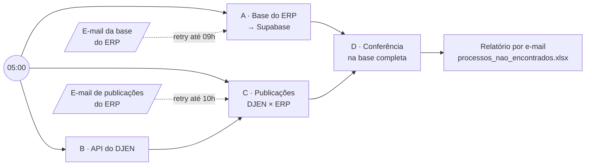

# Diários da Justiça · DJEN × ERP (n8n)

Workflow no n8n que confere todo dia as publicações do **DJEN** (Diário de Justiça Eletrônico Nacional) com a base de processos do **ERP** do escritório e envia à equipe só o que precisa de atenção.

- **Case completo:** https://pedronmpeixoto.github.io/projetos/diarios-djen/
- **Demo interativa (dados fictícios):** https://pedronmpeixoto.github.io/projetos/diarios-djen/demo.html

## O problema

As publicações chegavam em um documento Word. Uma pessoa copiava o número de cada processo, buscava no ERP e anotava se o processo estava cadastrado e se aquela publicação tinha sido captada. O trabalho crescia junto com o volume de publicações, e um número copiado errado ou uma linha pulada podia virar prazo perdido.

## Como o workflow resolve

Todo dia às 05:00, em uma única execução:

| Seção | O que faz |
|---|---|
| **A** | Lê o e-mail diário do ERP com a base de processos (HTML compactado), converte as linhas e faz *upsert* em lotes de 500 no Supabase. |
| **B** | Consulta as publicações do dia na API, uma pesquisa por termo cadastrado, e consolida tudo em uma lista. |
| **C** | Cruza as publicações do DJEN com as que o ERP captou e fica só com as que o ERP não trouxe. Adiciona a coluna **Tribunal** (TJ, TRT, TRF, STJ…). |
| **D** | Confere o resultado contra a base completa: remove processos baixados e duplicados, considerando a instância (TST × originário), e indica a **Pasta** ou `SEM CADASTRO`. |

**Robustez**

- **Retentativa:** os e-mails do ERP não têm horário garantido. O fluxo checa de novo a cada 20 minutos até um horário-limite e, se estourar, avisa no WhatsApp em vez de falhar em silêncio.
- **Calendário:** na segunda-feira usa as publicações de sexta. No fim de semana atualiza a base, mas não cruza publicações.
- **Uma execução só:** as seções trocam dados em memória, sem planilhas intermediárias.

## Uso de IA

O fluxo foi construído com apoio do Claude, que ajudou a:

- transformar a rotina manual em regras de cruzamento (como casar o número do processo, o que conta como "não captado" e o que tirar do relatório);
- escrever e revisar os nós de código em JavaScript (parser da base, retentativa, chave processo + instância, filtros de status);
- gerar a demo interativa com dados fictícios a partir do export do workflow, sem credenciais.

A arquitetura, as decisões de negócio e a validação com a equipe foram feitas por mim.

## Como importar

1. No n8n: **Workflows → Import from File** → [`workflow/diarios-djen-erp.json`](workflow/diarios-djen-erp.json).
2. Crie a tabela no Supabase com [`sql/base_erp.sql`](sql/base_erp.sql).
3. Configure as credenciais nos nós que pedem:
   - **Outlook** (Microsoft OAuth2): leitura dos e-mails do ERP e envio do relatório;
   - **Postgres (Supabase)** e **Supabase**: upsert e consulta da base;
   - **Evolution API (WhatsApp)**: alertas. Ajuste também `SUA_INSTANCIA` e `SEU_GRUPO@g.us`.
4. Defina as variáveis de [`.env.example`](.env.example) na instância. Os nós de código leem `$env`, então `N8N_BLOCK_ENV_ACCESS_IN_NODE` precisa estar `false`.
5. Ajuste o remetente (`no-reply@erp.exemplo.com`), os assuntos dos e-mails e o destinatário do relatório (`equipe@exemplo.com`).

> Este repositório não contém credenciais, dados de clientes nem identificadores da instância original. Endereços, hosts e nomes de credenciais são marcadores.

## Stack

n8n · JavaScript · Supabase / PostgreSQL · Microsoft Graph (Outlook) · Evolution API (WhatsApp)
